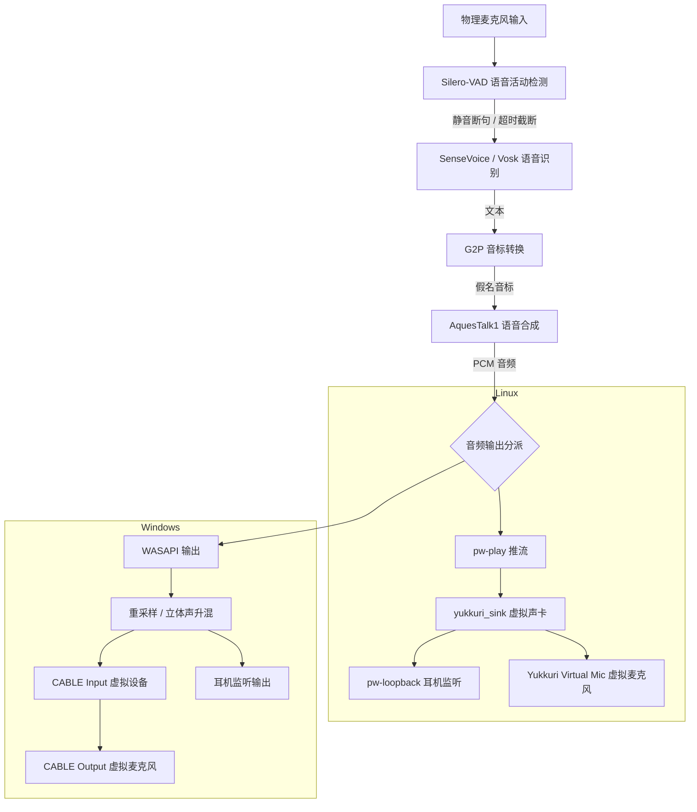

# yukkuri_app

[%20%7C%20Windows%20(WASAPI)-blue.svg)](https://github.com/2onic/yukkuri_app)
[](https://www.python.org/)
[](https://github.com/FunAudioLLM/SenseVoice)
[](https://www.a-quest.com/)
[](LICENSE)

一个跨平台的实时语音转油库里音效虚拟麦克风工具，支持 Linux (PipeWire) 与 Windows (WASAPI)。

输入中文、英文或日文语音，程序进行实时识别后通过 AquesTalk1 引擎合成为油库里假名语音，并推流至虚拟麦克风，供 Discord、OBS、会议软件等直接调用。

---

## 主要功能

- **声线支持**：
  - 支持 9 种声线：`f1`（女声1）、`f2`（女声2）、`f3`（女声3）、`m1/m2`（男声1/2）、`imd1`（中性音）、`jgr`（老者音）、`dvd`（电台音）、`r1`（机器人音）；
  - 支持在运行中直接切换声线。
- **发音转换 (G2P)**：
  - 中文：汉字转拼音并映射为假名（例如“你好” -> `にー/はお`）；
  - 英文：单词音译与字母拼读（例如“Hello world” -> `へろー/わーるど`）；
  - 日文：原生假名转换与读音校正；
  - 支持中英日混合输入。
- **语音活动检测与切片 (VAD)**：
  - 基于 Silero-VAD 进行静音停顿切片（断句间隔 200ms ~ 700ms 可调）；
  - 支持单句最大录音长度限制（默认 6.0s，可自定义或关闭），防止环境底噪导致长音频积压。
- **音量增益与电平监控**：
  - 麦克风输入与合成输出增益可调（0.1x ~ 3.0x）；
  - 界面提供输入音量条与监听/说话状态显示。
- **音频推流与监听**：
  - **Linux**：通过 PipeWire / PulseAudio 推流至 `yukkuri_sink`，自动创建虚拟麦克风；
  - **Windows**：通过 WASAPI 共享模式推流至虚拟声卡（如 VB-CABLE Input），支持采样率转换与声道升混；
  - 支持开启回放监听，通过耳机同步收听合成声音。

---

## 运行架构



---

## 安装与配置

### 1. 安装依赖

```bash
git clone https://github.com/2onic/yukkuri_app.git
cd yukkuri_app

pip install -e .
```

### 2. 模型下载与 AquesTalk 动态库导入

运行配置脚本下载离线模型：

```bash
# 下载识别模型与 VAD 模型：
python setup_models.py

# 导入 AquesTalk 动态库（支持 zip、目录或 dll/so 路径）：
python setup_models.py --aquestalk [路径]

# 检查当前模型与声线状态：
python setup_models.py --check
```

> **关于 AquesTalk 授权**：  
> AquesTalk 动态库（`libAquesTalk.so` / `AquesTalk.dll`）版权属于 [株式会社アクエスト (Aquest Corp.)](https://www.a-quest.com/)，本项目不内置分发其动态库。用户需自行前往 [AQUEST 下载页](https://www.a-quest.com/download.html) 获取对应平台的评价版（Windows 为 `AquesTalk.dll`，Linux 为 `aqtk1_lnx_200.zip`），再通过配置脚本或 GUI 界面导入。

---

### 3. 运行程序

#### 桌面图形界面 (GUI)

- **Windows**：双击 `run.bat`，或执行 `python -m yukkuri.cli --gui`
- **Linux**：执行 `./run.sh --gui` 或全局命令 `yukkuri-gui`

#### 命令行模式 (CLI)

```bash
# 默认启动
python -m yukkuri.cli

# 开启耳机监听并指定声线
python -m yukkuri.cli --loopback --voice f2
```

---

## Windows 使用说明

1. **启动程序**：
   - 双击根目录下的 `run.bat`，脚本会自动检测 Python 环境并打开 GUI；也可以在终端运行 `python -m yukkuri.cli --gui`。
2. **模型与声线**：
   - 首次使用可在界面中点击“语音模型与声线库管理”下载识别模型，并导入 `AquesTalk.dll`。
3. **音频设备设置**：
   - **虚拟麦克风**：安装 [VB-Audio Virtual Cable](https://vb-audio.com/Cable/) 后，在第三方语音软件（Discord、OBS、微信等）中将麦克风输入选为 `CABLE Output (VB-Audio Virtual Cable)`；
   - **耳机监听**：勾选“回放监听”并选择耳机设备，可直接通过耳机收听合成语音。

---

## AquesTalk 授权密钥配置

AquesTalk1 免费评价版会在部分发音中插入 "nu" 音作为限制。如果有官方授权密钥（DevKey 或 UsrKey），可通过以下方式配置解除限制：

### 配置方式（优先级由高到低）

1. **`.env` 文件（推荐）**：
   在项目根目录下创建 `.env`：
   ```ini
   AQUESTALK_DEV_KEY=your_key_here
   # 或
   AQUESTALK_USR_KEY=your_key_here
   ```
2. **环境变量**：
   - Windows (PowerShell): `$env:AQUESTALK_DEV_KEY="your_key_here"`
   - Linux: `export AQUESTALK_DEV_KEY="your_key_here"`
3. **命令行参数**：
   ```bash
   python -m yukkuri.cli --dev-key "your_key_here"
   ```

---

## 命令行参数

| 参数 | 默认值 | 说明 |
| :--- | :--- | :--- |
| `--engine` | `sensevoice` | 识别引擎：`sensevoice` 或 `vosk` |
| `--voice` | `f1` | 合成声线：`f1`, `f2`, `f3`, `m1`, `m2`, `imd1`, `jgr`, `dvd`, `r1` |
| `--speed` | `100` | 语速百分比 (50 ~ 300) |
| `--mic-gain` | `1.0` | 麦克风输入增益 (0.5 ~ 3.0) |
| `--output-gain` | `1.0` | 合成输出增益 (0.1 ~ 3.0) |
| `--max-speech-duration` | `6.0` | 单句最大截断时长（秒，<=0 表示不截断） |
| `--no-max-speech` | - | 关闭单句截断 |
| `--loopback`, `--monitor` | 关闭 | 开启本地耳机监听 |
| `--device` | 系统默认 | 输入麦克风设备 ID |
| `--output-device` | 系统默认 | 推流输出设备 ID（Windows 默认匹配 `CABLE Input`） |
| `--monitor-device` | 系统默认 | 监听输出设备 ID |
| `--lang` | `zh` | 主语种（`zh`, `ja`, `en`） |
| `--target` | `yukkuri_sink` | Linux PipeWire 目标 Sink 名称 |
| `--no-dynamic-mic` | - | 禁用 Linux pactl 自动管理虚拟声卡 |
| `--dev-key` | 无 | AquesTalk 开发密钥 (DevKey) |
| `--usr-key` | 无 | AquesTalk 使用密钥 (UsrKey) |
| `--list-devices` | - | 列出可用音频设备并退出 |
| `--gui` | - | 启动图形界面 |

---

## 版权与免责声明

1. **AquesTalk1**：
   - 本项目不包含或分发任何 AquesTalk 二进制动态库，亦不提供授权密钥；
   - 动态库（`libAquesTalk.so` / `AquesTalk.dll`）版权归 [株式会社アクエスト (Aquest Corp.)](https://www.a-quest.com/) 所有，不受本项目 MIT 协议管辖；
   - 商用需求请向官方申请授权。
2. **开源组件**：
   - SenseVoice、sherpa-onnx、Vosk：Apache-2.0 协议；
   - Silero VAD、CustomTkinter：MIT 协议；
   - PipeWire：MIT / LGPL 协议；
   - SciPy、NumPy：BSD-3-Clause 协议；
   - VB-Audio Virtual Cable 属于 VB-Audio Software 独立产品。
3. **免责声明**：
   - 本工具仅供技术交流与个人使用；
   - 使用者对通过本工具采集、合成并传播的音频内容承担全部责任。
